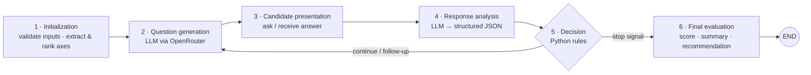

<div align="center">

# 🧑‍💼 HR Pre-selection Interview Chatbot

**A LangGraph interview agent that asks adaptive questions from a CV and a job profile, analyses answers, and scores the candidate — with business rules kept in Python, not delegated to the LLM.**


</div>

---

## 📌 Overview

Given a **candidate CV** and a **job requirement** (both JSON), the system conducts a short structured interview. It extracts the **axes to test** (mandatory skills, appreciated skills, soft skills, experience…), asks one question at a time, analyses each answer, decides whether to **clarify, deepen, re-ask or move on**, and finally produces a **score, summary, strengths, weaknesses and a recommendation**.

**Design principle — hybrid control.** The LLM is used for *language* (question generation, qualitative answer analysis, final write-up). **Decisions and scoring are deterministic Python logic**, which makes the interview auditable (`decision_trace`) and reproducible.

## 🧭 Interview Graph



### Decision logic (Python)

| Analysed answer nature | Follow-up type |
|---|---|
| vague / empty | clarification |
| partial | deepening |
| off-topic / incomprehensible | reformulation |
| contradictory | inconsistency check |

- Scoring multipliers depend on answer quality (*Excellente → Indéterminée*) and answer nature (*sufficient → refusal / no competence*).
- Axis weights: critical **0.18**, important **0.10**, secondary **0.05**.
- Limits: **8 questions** max, **1 follow-up per axis**, early stop when a critical failure is detected with confidence ≥ **0.75**.
- A shared `InterviewState` tracks covered / validated / weak axes, critical failures, inconsistencies and the decision trace.

## 🔌 REST API

| Method | Endpoint | Description |
|---|---|---|
| GET | `/health` | Service status |
| POST | `/interview/start` | Body `{cv, job, score_matching_initial?}` → `session_id`, first question, summary |
| POST | `/interview/{session_id}/answer` | Body `{answer}` → next question, or the final result when `status = completed` |
| GET | `/interview/{session_id}` | Session status |

Interactive docs: `http://127.0.0.1:8000/docs`.

## 🧰 Tech Stack

| Role | Tools |
|---|---|
| Orchestration | LangGraph (stateful graph), LangChain |
| LLM access | OpenRouter (default `meta-llama/llama-3.1-8b-instruct`, temperature 0.3) through `langchain-openai` |
| API & schemas | FastAPI, Uvicorn, Pydantic |
| Config | python-dotenv |

## 🗂️ Structure

```text
api.py · main.py          REST API / CLI entry points
graph/langgraph_builder.py   Graph definition
nodes/                    initialization · question_generation · candidate_presentation
                          response_analysis · decision_node · final_evaluation
models/                   InterviewState, API and LLM output schemas
config/                   OpenRouter settings, prompts, interview parameters
services/interview_service.py   Session handling for the API
data/                     Sample CV and job (synthetic)
```

## 🚀 Run

```bash
pip install -r requirements.txt
cp .env.example .env            # set OPENROUTER_API_KEY (never commit it)

uvicorn api:app --reload        # REST API → http://127.0.0.1:8000/docs
python main.py                  # CLI interview on the sample data
python validate.py              # environment / structure check
```

Sample inputs are in [`data/`](./data) (a *Data Scientist* job and a fictional candidate).

## ✅ Verification Status

On Python 3.10 with the pinned `requirements.txt`: the dependencies install, `validate.py` reports all imports OK (it only flags the missing `.env`), the LangGraph graph compiles, and the FastAPI app exposes `/health`, `/interview/start`, `/interview/{session_id}` and `/interview/{session_id}/answer`. **No LLM call was executed** (no API key), so interview quality and scoring were not exercised end to end.

## 📊 Evaluation

No quantitative evaluation (e.g. agreement with human recruiters, question quality) is included in the repository. The scoring weights and thresholds are **design parameters**, not validated against hiring outcomes.

## ⚠️ Responsible Use

Automated candidate scoring can encode bias. This tool is a **pre-screening aid for experimentation**; it must not be the sole basis for hiring decisions, and real candidate data should be handled under applicable privacy rules.

## 🔭 Limitations & Future Work

- Depends on one small hosted LLM; answer analysis quality is unmeasured.
- Sessions are held in memory (no persistence / multi-user storage).
- Add automated tests for decision rules, a rubric-based evaluation set, and bias audits.
- Upgrade LangChain/LangGraph (the pinned versions are old) and add a simple web front-end.

## 👤 Author

**Nour Ghribi** · [GitHub](https://github.com/Nour-Ghribi)
